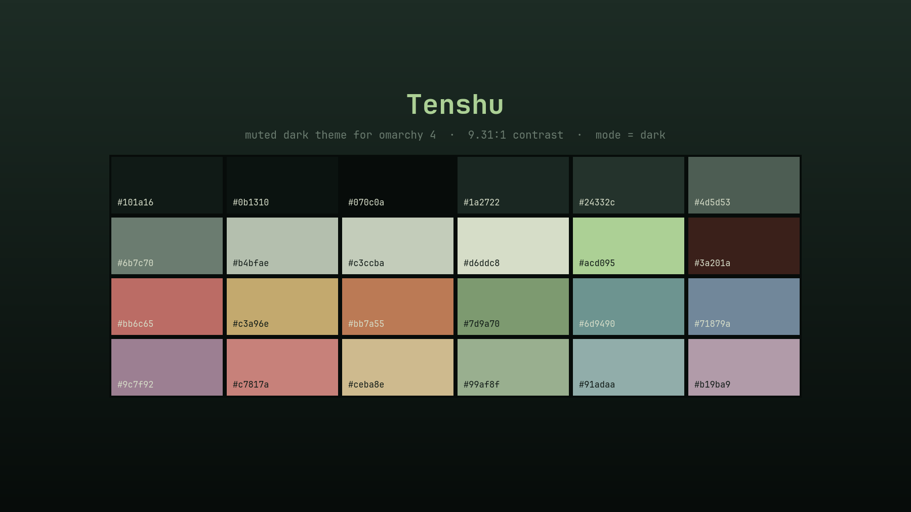

# Tenshu

A muted dark theme for [Omarchy](https://omarchy.org) 4 (Quattro), named for the castle
keep it was drawn from: a *tenshu* under a full moon, banners at its foot, windows lit
from within.

The deepest green of the set. Where the other three sit on indigo, teal-black and
blue-slate, this one is a forest-dark green — and it is the only one with a **cool
accent**, taken from the moonlight rather than from a lamp.



## Install

```bash
omarchy theme install https://github.com/LizinDev/omarchy-tenshu-theme.git
```

Installing applies the theme right away. To switch back to it later, run
`omarchy theme set tenshu`; to uninstall it, run `omarchy theme remove tenshu`.

## Palette

| Role | Hex | |
|---|---|---|
| background | `#101a16` | terminals, bar, popups, menus |
| foreground | `#b4bfae` | all body text — 9.31:1 on background |
| accent | `#acd095` | borders, shortcuts, selected rows |
| selection | `#24332c` | text selection, btop meters |
| muted | `#4d5d53` | ANSI bright-black, dividers |

ANSI: `#bb6c65` red · `#7d9a70` green · `#c3a96e` yellow · `#71879a` blue ·
`#9c7f92` magenta · `#6d9490` cyan.

The border gradient runs moonlight sage → window coral (`#acd095` → `#c2705c`): the
picture's two light sources, on opposite sides of a very dark green field.

The sage accent is not only aesthetic. A warm accent taken from the lit windows landed
only 7.7 ΔE from ANSI red, which would have made a focused border and an error border
look alike. Moving the accent to the moonlight instead puts 59.5 ΔE between them.

## What's here

| File | |
|---|---|
| `colors.toml` | the palette — generates 17 app configs on its own |
| `hyprland.lua` | sage→coral border gradient + a cool shadow on the focused window |
| `shell.{menu,launcher,tooltip,lock}.toml` | per-section shell overrides |
| `icons.theme` | `Yaru-sage-dark` |
| `backgrounds/` | a palette-derived gradient (see below) |
| `preview.png` | theme-switcher tile |
| `unlock.png` | Plymouth boot splash and SDDM logo |

## Backgrounds

Only `3-tenshu-void.png` ships here — a plain gradient generated from the palette. The
theme was designed against a piece of pixel art, but that is someone else's work and is
not redistributed. Drop your own in:

```bash
cp <your-wallpaper> ~/.config/omarchy/themes/tenshu/backgrounds/1-tenshu.png
omarchy theme set tenshu
```

## Caveats

**Installed from a git clone, this theme loses `hyprland.lua`.** Omarchy drops every
`.lua`, terminal config and `vscode.json` from a cloned theme, because each names
something to run. The palette and the border gradient survive — they live in
`colors.toml` — but not the window shadows.

**`shell.*.toml` overrides replace their whole section, they don't merge.** Each file
here restates the complete section, and its hex values are frozen copies of
`colors.toml`. Re-sync them if you change the palette — `shell.lock.toml` in particular
carries `red` twice, as `text-error` and `border-error`.

## Working on it

Keep the repo outside `~/.config/omarchy/themes` and symlink it in. A directory with a
`.git` inside is treated as somebody else's theme and staged under restrictions; a
symlink is not.

```bash
git clone <this-repo> ~/Projects/omarchy-tenshu-theme
ln -s ~/Projects/omarchy-tenshu-theme ~/.config/omarchy/themes/tenshu
omarchy theme set tenshu
```

Iterate with `omarchy theme refresh`.

## License

The theme files are released under the [MIT License](LICENSE). The pixel art the palette
was designed against is someone else's work. It is not in this repository and the
license does not cover it.
